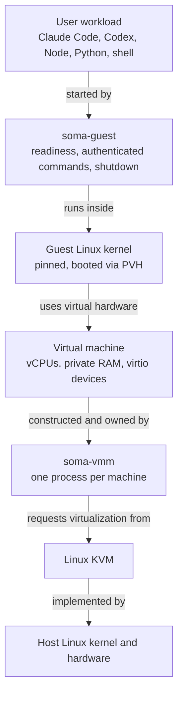
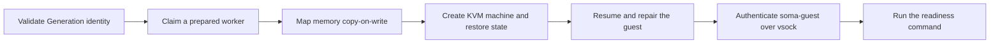

SOMA 是 Secure Optimized Machine Architecture 的缩写，也是 MIOSA 构建并运行沙箱所依托的虚拟机监视器。
它采用 Apache License 2.0 开源，代码位于 [Miosa-osa/SOMA](https://github.com/Miosa-osa/SOMA)，使用 Rust 编写，运行在 Linux KVM 上。

SOMA 沙箱不是容器，也不是用户态内核。
它是一台硬件隔离的 Linux 虚拟机，拥有自己的客户机内核和私有内存，由单个 VMM 进程创建并持有，生命周期恰好对应一个沙箱。

> **注意：您不必自行运行它**
>
> MIOSA 会为您运行 SOMA。本页介绍您已经创建的沙箱和计算机底层所依托的机制。
> 如果您只想了解用于选择运行时的 API 开关，请阅读[选择运行时](/docs/soma/choosing-a-runtime)。

## SOMA 是什么

SOMA 是面向 Linux 客户机的 type-2 VMM，以及围绕它的启动运行时。
它通过半虚拟化的 PVH 入口直接启动固定版本的 Linux 内核，因此没有 BIOS 或 UEFI 阶段，并且只向客户机暴露一组刻意保持极小的虚拟设备。

这种设计带来三个结果：

- **每个沙箱都实现硬件隔离。** 客户机运行在由 KVM 支撑的虚拟 CPU 上。它是一个拥有自己页表的真实内核，而不是系统调用过滤器或被沙箱化的进程。
- **机器小而固定。** SOMA 机器契约 v1 最多暴露五个 virtio 设备，且完全没有 PCI 总线。设备暴露面越小，恶意客户机可攻击的位置就越少。
- **从经过认证的快照启动，而不是从开机开始。** 高成本工作只在构建 Generation 时执行一次。启动时会恢复一台已预热的机器，然后验证客户机确实存活。

SOMA 不是容器运行时、提供商控制平面或计费系统。
MIOSA 平台负责调度、租户、策略和公开的沙箱 API，SOMA 则作为执行引擎位于其下。

## 我们为什么构建它

MIOSA 的沙箱过去运行在 Firecracker 上，目前 Firecracker 仍是默认选项（参见[选择运行时](/docs/soma/choosing-a-runtime)）。
我们构建 SOMA，是因为希望掌控整条启动链路，尤其是机器进入可执行命令状态的确切时刻；同时也因为希望拥有一个契约中不包含云厂商、提供商或固定机型假设的引擎。

目标直接来自[项目使命](https://github.com/Miosa-osa/SOMA/blob/main/MISSION.md)：

- 一个原生 VMM 进程只持有一台虚拟机。
- 恢复的内存使用不可变共享后备和私有写时复制映射，而不是急切复制整份 RAM 镜像。
- 每次恢复都会获得全新身份、熵状态、网络身份，并修复时钟。
- 就绪意味着经过认证的客户机智能体在修复后完成了一条真实命令，而不是某个套接字已打开。
- 公开契约不包含云厂商、提供商、计费层级或固定机型假设。

## 工作原理

从工作负载向下读到硬件。
每一层都使用其下一层，客户机从不直接与 KVM 或物理硬件通信。



### 构建阶段：Template、Generation、Instance

SOMA 将慢工作和快工作分开。

1. **Template**（一份 TOML 配方）会编译成 **Template Lock**，将镜像固定到一个精确的 OCI 摘要。
2. Generation 编译器将该锁和规范化根文件系统转换为不可变的 **Generation**：一个经过认证、自身永不运行的盒子。
3. 对该 Generation 的每次 **Launch** 都会打开一个私有 **Instance**，也就是一台拥有独立身份、内存和磁盘头的运行中机器。

Generation 自带固定版本内核、只读根文件系统、未受污染的可写磁盘模板、initramfs 和已签核的清单。
它的身份即 Generation ID，是该清单的 SHA-256。
由于清单按摘要指定每个产物，同一 Generation 的两个 Instance 在启动瞬间逐字节一致，但绝不会共享可变状态。

机型是构建参数，不是每次请求可调的旋钮。
一个 Generation 只针对一种 CPU、内存和磁盘机型编译，Launch 会断言该机型，而不是选择机型。
正因如此，内存镜像才能只捕获一次并恢复多次。

### 启动阶段：claim、restore、repair、prove

快速路径在设计上就很短：



- **已准备的 worker。** 节点本地分配器维护一个有界的已启动机器池，因此一次 Launch 通常通过单赢家交换领取一台机器，而不是从零启动。
- **写时复制内存。** 恢复的内存以只读方式共享，并按 Instance 私有映射。一个 Generation 可以为多个 Instance 提供后备，而无需每次复制其 RAM。
- **先修复，后就绪。** 恢复出来的客户机是一个克隆，因此 SOMA 会为它提供全新身份、全新熵、全新网络身份，并校正时钟。只有在客户机内智能体通过 vsock 完成认证并执行一条真实命令后，才会报告就绪。
- **无 shell。** 命令以参数向量而非 shell 字符串跨越边界，输出以明确的字节形式返回。

启动路径上的一切都有边界：时间、输出大小和控制响应数量。

### 设备暴露面

SOMA 机器契约 v1 最多暴露五个现代 virtio 1.0+ 设备，每个设备都位于各自固定的 virtio-mmio version 2 页：

| 设备 | 出现条件 |
|---|---|
| 不可变根块设备（EROFS） | 始终存在 |
| 私有可写覆盖块设备 | 声明了可写存储时 |
| vsock（控制与命令） | 始终存在 |
| 熵源 | 始终存在，确保恢复出的实例不会被重复使用 |
| 网络 | 声明了网络能力时 |

没有 PCI 总线、设备热插拔、图形、USB 或 BIOS。
设备集是 Generation 身份的一部分，因此在带覆盖层的机器上捕获的快照，绝不能恢复到没有该覆盖层的机器上。
这种不匹配会在映射任何内存字节之前被拒绝。

### 隔离与证据

一个 `soma-vmm` 进程只持有一台机器，且该进程运行在带有收窄系统调用过滤器的 jail 中。
客户机被视为敌对方：它发送的每个长度、偏移、描述符和协议帧都会在主机侧接受验证。
每次终端操作都会返回执行回执，其中列明不可变工作负载、实际生效的隔离级别、准备级别、结果、时间边界和清理状态。
如果某个维度无法证明，回执会如实说明，而不是编造一个值。

## SOMA 与 Firecracker

Firecracker 是一款强大且久经验证的 microVM 监视器，MIOSA 曾在其上运行多年。
我们构建 SOMA，是因为希望拥有一台可以从头到尾塑造的机器，从内核启动入口一直到就绪证明。
两者都是运行在 KVM 上的 Rust VMM；区别在于包裹机器的契约。

|  | SOMA | Firecracker |
|---|---|---|
| 构建方 | MIOSA，开源 | AWS，开源 |
| 语言 | Rust | Rust |
| 隔离 | KVM；每台机器一个进程 | KVM；每个 microVM 一个进程 |
| 客户机内核 | 每个沙箱一个固定版本内核 | 每个 microVM 一个内核 |
| 启动入口 | PVH；无 BIOS 或 UEFI | 项目内核策略 |
| 设备模型 | 五个 virtio-mmio 设备；无 PCI | 小型模型；基于 MMIO 的 virtio |
| 主机加固 | Jail 中的 VMM；seccomp；cgroups | Jailer；seccomp；cgroups |
| 热启动 | 恢复到已准备的 worker | 快照恢复 |
| 启动数字 | 准入目标，而非已实现声明 | 项目性能规范 |
| 虚拟机外围契约 | 身份修复、就绪、回执 | 仅提供机制 |

“启动数字”两格都不是正面对比结果。
Firecracker 自己的性能规范定义了典型 API 墙钟时间为 12 ms，客户机 init 启动不超过 125 ms，VMM 开销不超过 5 MiB。
SOMA 的准入目标更低：服务端创建低于 5 ms，首次执行命令低于 10 ms，但这些是针对仍在认证中的路径设定的目标，而非实测结果。
Firecracker 的规范也不包含恢复时的身份修复或经过认证的就绪证明，而这正是 SOMA 要弥补的差距。

MIOSA 自己公布的数字是产品级数据，不是引擎级数据。
在 2026-10-23 的独立 ComputeSDK 突发基准测试中，MIOSA 以 57.09 ms 的突发交互时间中位数在 32 家提供商中排名第一。
每次运行和原始 JSON 参见[基准测试](/docs/benchmarks)。

## 开源

SOMA 公开可用，采用 [Apache License 2.0](https://github.com/Miosa-osa/SOMA/blob/main/LICENSE) 许可，与 Firecracker 使用同一许可证。仓库还包含一个 [NOTICE](https://github.com/Miosa-osa/SOMA/blob/main/NOTICE) 文件（Copyright 2026 MIOSA LLC），工作区也以相同方式声明许可证。
MIOSA 和 SOMA 的名称与徽标由 [BRAND.md](https://github.com/Miosa-osa/SOMA/blob/main/BRAND.md) 单独覆盖。

仓库对其现状保持诚实：源代码版本为 `1.0.0-alpha.1`，项目维护一份[声明台账](https://github.com/Miosa-osa/SOMA/blob/main/docs/claim-ledger.md)，将每项能力标注为已设计、已通过组件测试、已在实机验证、已集成或已获生产准入，并附上相应证据。

要在自己的机器上试用，目前支持的本地方案是 macOS 上的 Docker Desktop 或 Linux 上的 Docker Engine；自定义 KVM 引擎需要带有 `/dev/kvm` 的 Linux 主机：

```sh
git clone https://github.com/Miosa-osa/SOMA.git
cd SOMA
cargo run --locked -p soma-cli -- doctor
cargo run --locked -p soma-cli -- --backend docker run node:22 -- /usr/local/bin/node --version
```

要参与贡献，请先阅读 [CONTRIBUTING.md](https://github.com/Miosa-osa/SOMA/blob/main/CONTRIBUTING.md) 和 [MISSION.md](https://github.com/Miosa-osa/SOMA/blob/main/MISSION.md)。
Rust 改动需要通过对格式检查、禁止警告的 clippy 检查以及完整的工作区测试套件。
安全问题请通过 [SECURITY.md](https://github.com/Miosa-osa/SOMA/blob/main/SECURITY.md) 中的私下流程报告，绝不要提交公开 issue。

## 状态

SOMA 面向所有客户开放。
创建沙箱时，可通过 REST API、SDK、CLI 或控制台选择该运行时。
Firecracker（`standard`）仍是默认选项。

`GET /api/v1/sandboxes/runtimes` 会列出各运行时以及它们目前声明支持的能力，因此您可以在选择 SOMA 前读取其实时能力标志。

创建示例和机型规则参见[选择运行时](/docs/soma/choosing-a-runtime)。

目前已知的差距：

- **SOMA 上的沙箱尚不支持持久化。** 状态无法在停止或超时后保留；一次性沙箱会在超时后删除。SOMA 创建操作默认 `persistent: false`，在 SOMA 上使用 `persistent: true` 会以 `422` 拒绝。
- **计算机仍运行在 Firecracker 上。** 只有沙箱提供运行时选择。
- **没有公开的单沙箱引擎延迟数据。** 公布的基准测试是 MIOSA 的产品级突发数据，并未细分 SOMA 的内部阶段。
- **功能对等尚未完成。** SOMA 自己的声明台账列出了已集成、已在实机验证以及仍处于设计阶段的能力。

- [选择运行时](/docs/soma/choosing-a-runtime)：在创建沙箱时选择 SOMA 或 Firecracker，并了解每个选项的要求。
- [基准测试](/docs/benchmarks)：MIOSA 在独立 ComputeSDK 基准测试中的结果。
- [规格与限制](/docs/develop/sandboxes/sizing)：具名资源契约和 SOMA 单跳 runner 快速路径。

## 常见问题

**SOMA 是 Firecracker 的分支吗？**
不是。SOMA 是独立实现，基于 Linux KVM 接口和 virtio 规范，使用 Rust 从头编写。

**我的沙箱已经在 SOMA 上运行了吗？**
如果您没有请求特定运行时，沙箱会运行在 Firecracker 上，它仍是默认选项。SOMA 面向所有客户开放，需通过 `runtime_profile` 显式选择。无论哪种方式，产品契约、API 和您的数据都完全相同。

**我可以在自己的硬件上运行 SOMA 吗？**
可以。仓库公开且采用 Apache-2.0 许可。目前自定义 KVM 引擎需要带有 `/dev/kvm` 的 Linux 主机；Apple 和 Docker 后端可用于本地开发。

**每个沙箱都有独立内核吗？**
有。每个 Instance 都会启动该 Generation 固定版本 Linux 内核的独立副本，因此某个沙箱中的内核缺陷不会与邻近沙箱共享同一内核。

**我的容器可以放在哪里？**
SOMA 沙箱是一台虚拟机，因此您可以在其中运行容器运行时。客户机内部是您的边界；SOMA 是客户机外围的边界。

**SOMA 适合不受信任的生产工作负载吗？**
SOMA 将客户机视为敌对方并验证其发送的一切，但项目仍标记为 alpha。请将其视为一款可检查、快速演进的引擎，而不是已完成审计的成品。
