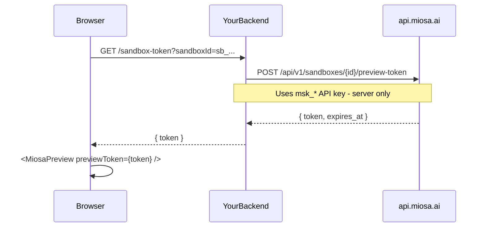

`@miosa/react`、`@miosa/vue` 和 `@miosa/svelte` 是即插即用的组件库，可让你在自己的前端中直接嵌入运行中的 MIOSA 沙盒——无需 iframe 胶水代码，无需 WebSocket 接线，也无需 API 管道。

每个包都提供四个可用于生产环境的组件：

| 组件 | 渲染内容 |
|---|---|
| `<MiosaPreview>` | 一个沙盒化 iframe，显示沙盒的 HTTP 预览 URL |
| `<MiosaTerminal>` | 一个完整的 xterm.js 终端，通过 WebSocket 连接到沙盒 PTY |
| `<MiosaFileTree>` | 一个交互式文件浏览器，由沙盒文件系统提供数据 |
| `<MiosaUsage>` | 一个按最终用户统计的用量摘要小组件（计算秒数、存储、出口流量） |

这些是面向客户的即插即用包：你的应用通过导入它们，在自己的前端中嵌入沙盒。它们与 MIOSA Foundation 组件库相互独立，后者是用于构建 MIOSA 产品本身的内部 UI 系统。产品 UI 系统、设计令牌、清理规则和可复用内部组件请使用[基础组件库](/docs/component-library)。

## 认证模型

> **注意：绝不要把 API 密钥放进浏览器**
>
> 你的 MIOSA API 密钥（`msk_*`）必须留在服务器上。接受 `apiKey` prop 的组件仅适用于**服务端渲染**或**受信任客户端**场景。对于面向公众的嵌入，请在后端生成短期预览令牌，并作为 `previewToken` 传入。

面向公众嵌入的推荐模式：



`<MiosaPreview>` 和 `<MiosaTerminal>` 都接受 `previewToken` 来代替 `apiKey`。令牌有效期很短（默认 1 小时），并限定用于单个沙盒。

## 选择哪个框架包

| 如果你使用…… | 安装 |
|---|---|
| React / Next.js / Remix | `@miosa/react` |
| Vue 3 / Nuxt 3 | `@miosa/vue` |
| Svelte 5 / SvelteKit | `@miosa/svelte` |

这三个包的组件 API 在结构上完全一致。Prop 名称、事件名称和行为都相同——只有导入路径和框架惯用法不同。

## 安装

**React**

```bash
npm install @miosa/react
# xterm peer deps  -  required only if you use MiosaTerminal
npm install @xterm/xterm @xterm/addon-fit
```

**Vue**

```bash
npm install @miosa/vue
# xterm peer deps  -  required only if you use MiosaTerminal
npm install @xterm/xterm xterm-addon-fit
```

**Svelte**

```bash
npm install @miosa/svelte
# xterm peer deps  -  required only if you use MiosaTerminal
npm install @xterm/xterm xterm-addon-fit
```

还要将样式表添加到应用入口点（仅 React——Vue 和 Svelte 自带作用域样式）：

```ts
import '@miosa/react/styles.css';
```

## 另请参阅

- [基础组件库](/docs/component-library)
- [React 组件](/docs/ui-components/react)
- [Vue 组件](/docs/ui-components/vue)
- [Svelte 组件](/docs/ui-components/svelte)
- [平台：浏览器令牌](/docs/platform/browser-tokens)
- [沙盒预览](/docs/develop/previews)
