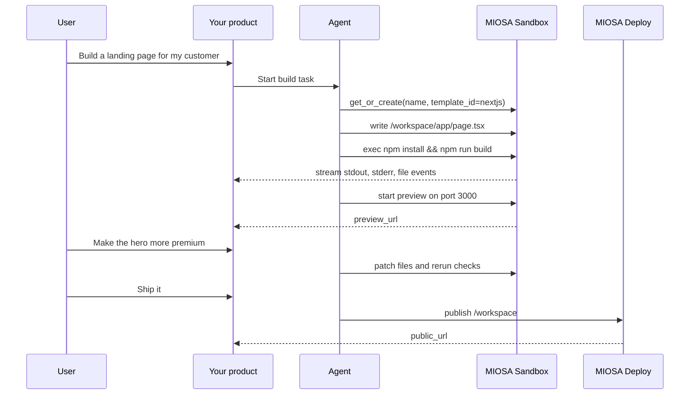

MIOSA 是 AI 产品底层的基础设施。你的产品或你的智能体可以获得真实机器和真实 URL：

- **沙箱**，用于代码、文件、构建和预览。
- **计算机**，用于浏览器和完整桌面，并支持人工接手。
- **智能体**，你可以派发任务、流式接收输出并收集其产物。
- **部署与 Docker Host**，用于在稳定 URL 上发布不可变版本，支持自定义域名和回滚。
- **平台功能**，用于白标产品：组织、工作区、限定范围的密钥、域名和用量计量。

```text
User request
  -> agent plans work
  -> sandbox does code, files, builds, tests, artifacts
  -> computer does browser, desktop, screenshots, manual-style tasks
  -> MIOSA streams events and previews
  -> deployment ships the finished app
```

MIOSA 不只是一个远程 shell。它是让需要 AI 智能体完成真实工作的产品得以安全运转的执行层。

## 浏览构建图库

下面的每种产品形态都在[构建图库](/docs/build)中配有分步指南：你需要的原语、架构图、从 API 密钥到自定义域名的六个步骤，以及一段可以直接交给编码智能体的提示词。

- [AI 应用构建器](/docs/build#bg-app-builders)：Lovable、Bolt、v0、Replit 风格：用提示词生成已部署的应用。
- [运行编码智能体](/docs/build#bg-run-coding-agents)：在云端运行 Claude Code、Codex、Cursor。
- [自主智能体](/docs/build#bg-autonomous-agents)：拥有自己机器并能完成工作的智能体。
- [浏览器与计算机使用智能体](/docs/build#bg-browser-computer-agents)：驱动真实浏览器或桌面的智能体。
- [AI 聊天与陪伴产品](/docs/build#bg-chat-companions)：助手和始终在线的陪伴型产品。
- [答案引擎](/docs/build#bg-answer-engines)：会引用来源的研究型产品。
- [多智能体](/docs/build#bg-multi-agent)：一个请求，多个智能体并行处理。
- [语音智能体](/docs/build#bg-voice-agents)：在通话中交谈并执行操作的智能体。
- [AI 设计工具](/docs/build#bg-design-tools)：用提示词生成设计稿或素材。
- [AI 视频与创意](/docs/build#bg-video-creative)：生成、编辑和制作媒体内容。
- [垂直 AI 应用](/docs/build#bg-vertical-ai)：面向特定行业工作流的智能体。
- [内部工具](/docs/build#bg-internal-tools)：让智能体、应用和数据共存的公司级操作系统。

---

## 构建者与开发者

- **提示词到应用构建器**：Lovable 和 v0 风格的产品，智能体把提示词变成线上应用，随后修复并重新发布。

  `Sandbox`
  `Preview`
  `Deployment`

  [从这里开始：构建 Lovable 风格的应用](/docs/build/lovable)
- **沙箱中的编码智能体**：在持久沙箱中运行 Claude Code、Codex 或 OSA，并配备真实代码仓库所需的文件、软件包和 shell。

  `Sandbox`
  `Agent runs`
  `Snapshots`

  [从这里开始：运行编码智能体](/docs/build/run-agents)
- **代码执行产品**：在隔离的 microVM 中运行不受信任的用户代码，流式输出 stdout，并收集它产生的产物。

  `Sandbox`
  `Events`
  `Artifacts`

  [从这里开始：流式代码执行](/docs/cookbook/streaming-code-execution)
- **评估与基准测试工具**：在真实运行时上运行可重复的评估和基准测试突发任务，每次运行都有证据，而不是模拟结果。

  `Sandbox`
  `Benchmarks`
  `Events`

  [从这里开始：评估](/docs/evaluations)和[基准测试](/docs/benchmarks)

## 智能体产品团队

- **拥有自己计算机的常驻智能体**：dots 和 Grok Bot 风格的智能体，跨会话保留设备、文件、浏览器和长时间运行的任务。

  `Sandbox`
  `Computer`
  `Agent devices`

  [从这里开始：智能体设备](/docs/guides/agent-devices)
- **浏览器自动化智能体**：每个沙箱都内置浏览器使用能力：智能体通过 CDP 驱动真实浏览器，同时人类可以观看。

  `Sandbox`
  `Browser use`
  `Live viewer`

  [从这里开始：浏览器使用](/docs/browser-use)
- **桌面与计算机使用智能体**：智能体在持久的 Linux 桌面上截图、点击和输入，遇到困难时可由人工接管。

  `Computer`
  `Computer use`
  `Embedding`

  [从这里开始：计算机使用](/docs/computer-use)

## 平台与智能体机构团队

- **白标智能体平台**：Lumen 风格的平台，使用你的品牌、你的域名和你的最终用户，而 MIOSA 在其背后运行。

  `Org and workspaces`
  `Branding`
  `Attribution`

  [从这里开始：平台构建者指南](/docs/platform/overview)
- **智能体机构客户平台**：Northwind 风格的智能体机构，为每个客户提供隔离的工作区，构建他们的应用，并交付域名。

  `Multi-tenant`
  `Quotas`
  `Custom domains`

  [从这里开始：平台构建者指南](/docs/platform/overview#northwind-agency-client-work)
- **面向团队的内部 Business OS**：Acme Corp 风格的内部平台，让你的团队智能体、应用和数据在 MIOSA 上共存。

  `Sandbox`
  `Connectors`
  `Data`

  [从这里开始：内部 Business OS](/docs/build/business-os)

## 基础设施与企业

- **自带机器**：OpenComputers 纳管你拥有的机器，让智能体在你自己的硬件上运行命令和操作文件。

  `OpenComputers`
  `Hosts`
  `Meshes`

  [从这里开始：OpenComputers](/docs/opencomputers)
- **使用 Fractal 的企业数据**：Fractal 为企业数据提供受治理的归所，让智能体在恰当的控制下对接你的系统。

  `Fractal`
  `Data`
  `Governance`

  [从这里开始：Fractal 企业数据](/docs/data/fractal)

> **注意：能力标签很重要**
>
> MIOSA 目前可以为这些产品承载应用、数据、工作流、客户边界和部署。
> 专用模型和媒体执行可能会使用接入的提供商。
> 托管 GPU 执行和客户云部署仍处于受限状态，直到可用性页面将其标记为已上线。
> 参见[可用性与路线图](/docs/availability)。

---

## 产品原语

| 原语 | 适用场景 | 不适用场景 |
|---|---|---|
| **沙箱** | 代码、文件、命令、软件包安装、构建、测试、生成产物、预览服务器 | GUI/浏览器交互 |
| **计算机** | 浏览器自动化、截图、鼠标/键盘、桌面应用、视觉 QA、用户接手 | 不需要桌面的无头代码构建 |
| **部署** | 稳定的公共应用/站点/API URL、版本、发布、回滚 | 活跃的开发迭代 |
| **Docker Host** | 在单个工作区的 Docker Host 上，将多个客户应用作为隔离容器运行 | 通用沙箱开发 |
| **产物** | 智能体创建的文件：PDF、文档、图片、报告、导出文件、截图 | 隐藏的临时状态 |
| **事件** | 实时 UI 更新：工具调用、stdout、文件写入、预览就绪、部署状态 | 长期存储 |

## 构建智能体公司式产品

多款现代 AI 产品都封装了同一个高层模式：智能体、持久工作区、连接的应用、浏览器或云端设备、任务、文件以及生成的交付物。MIOSA 直接提供这些原语，因此你可以在自己的产品中构建自己的版本。

```text
Your product UI
  -> agent configuration
  -> device policy
  -> sandbox/computer/local device
  -> connected accounts and managed connectors
  -> streamed tool calls and events
  -> files, artifacts, previews, jobs, and deployments
```

| 产品形态 | MIOSA 原语 |
|---|---|
| 常驻虚拟设备 | 持久沙箱或计算机、主设备策略、快照、任务 |
| 智能体团队 | 编排器、子沙箱、子计算机、共享产物、事件流 |
| 迷你应用构建器 | Next.js 沙箱、预览 URL、产物面板、发布流程 |
| 操作员智能体 | 浏览器计算机、连接的应用、计划任务、审批、记忆 |
| 设计/研究智能体 | Web 研究、托管研究连接器、文件、浏览器截图 |
| 7×24 监控任务 | 计划触发器、持久设备、应用连接器、通知 |

重要的架构要点是：智能体应该在 MIOSA 设备中工作。本地 CLI、MCP 客户端或你的后端负责编排，但文件、命令、浏览器操作、预览和产物都存放在所分配的运行时中。

完整模型参见[构建智能体公司平台](/docs/guides/build-agent-company)、[MIOSA 智能体能做什么](/docs/guides/agent-capabilities)、[智能体设备](/docs/guides/agent-devices)和[智能体编排](/docs/guides/agent-orchestration)。

> **提示：默认智能体循环**
>
> 对于 AI 编码产品，默认循环应该是沙箱优先：创建或恢复沙箱，在 `/workspace` 内写入文件，在沙箱内运行命令，展示预览，快照进度，然后发布。

---

## 示例：生成式应用构建器



你的前端可以展示用户期望现代 AI 构建器提供的那条工作流：工具调用、命令输出、生成的文件、预览链接、截图以及最终部署 URL。

---

## 示例：产物工作区

当输出是一个文件而不是已部署的应用时，使用沙箱。

```text
User asks for a proposal
  -> agent writes Python or Node generator
  -> sandbox creates proposal.html
  -> sandbox renders proposal.pdf
  -> sandbox creates proposal.docx
  -> product shows artifacts in a side panel
  -> user downloads or asks for edits
```

适合产物输出的场景：

- 客户提案
- 路演幻灯片
- 数据报告
- PDF 发票
- SVG 图表
- PNG 图表
- HTML 预览
- ZIP 打包文件
- 代码归档

---

## 两种沙箱选择，都能覆盖这些工作

| 选择 | 预期用途 |
|---|---|
| 默认沙箱（`miosa-sandbox`） | 在一个地方完成所有工作：Python 和 Node 执行、生成 Web 应用、报告和产物、浏览器测试以及带数据库的应用。 |
| 桌面（`miosa-desktop`） | GUI 工作和人工接管，当有人需要查看并操作屏幕时使用。 |

产品形态保持不变：启动默认沙箱，让智能体在其中工作。

---

## 在产品中向用户展示什么

用户不应该需要理解虚拟机内部细节。向他们展示有用的工作：

- 当前任务和计划
- 工具调用
- 命令输出
- 创建或编辑的文件
- 生成的产物
- 预览 URL
- 浏览器检查产生的截图
- 部署 URL
- 回滚/版本历史
- 额度和运行时用量

传达的信息应该是：“你的智能体正在真实的云工作区中工作。你可以观看它、检查文件、预览结果，并在准备好时发布。”

---

## 另请参阅

- [查看你可以构建的应用](/docs/build)：20 多种产品形态的分步指南，从 Lovable 和 Bolt 到 Devin 和内部 Business OS。
- [构建智能体公司平台](/docs/guides/build-agent-company)：将常驻设备和操作员智能体映射到 MIOSA 原语。
- [后端编排](/docs/integrations/backend-orchestration)：构建 API 层，把提示词派发到沙箱、计算机和本地设备。
- [智能体编排](/docs/guides/agent-orchestration)：协调沙箱智能体、计算机智能体、产物、事件和部署。
- [沙箱](/docs/develop/sandboxes)：用于文件、命令、预览、快照和发布的持久代码工作区。
- [计算机](/docs/computers/overview)：用于截图、点击、上传、视觉 QA 和人工接手的桌面/浏览器运行时。
